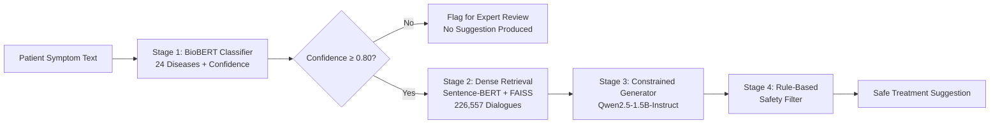

# PathoGen

**An Uncertainty-Aware, Retrieval-Augmented, and Safety-Checked Pipeline for Symptom-Based Disease Prediction and Treatment Suggestion**

> **Medical Disclaimer:** PathoGen is an unvalidated student research prototype developed for academic evaluation. It has **not** undergone clinical validation and must **not** be used for real-world medical diagnosis, triage, or treatment decisions.

---

## Overview

Converting free-text patient symptom descriptions directly into medical advice with language models introduces two core risks: confident misclassifications when symptoms overlap across conditions, and fluent hallucinations that recommend specific medications, dosages, or treatments contradicting the working diagnosis.

Adapting the CLIN-LLM workflow, **PathoGen** addresses these risks through a gated, four-stage pipeline that predicts a condition, defers uncertain inputs to expert review, grounds generation in retrieved doctor–patient consultations, and filters unsafe outputs before display.



---

## Pipeline Architecture

* **Stage 1 — Uncertainty-Aware Classification (`BioBERT`):** Fine-tunes `dmis-lab/biobert-base-cased-v1.2` with a 24-way classification head (max sequence length `128`, batch size `16`, weight decay `0.01`, `30` warm-up steps, `12` epochs at learning rate `5e-5`, best checkpoint at epoch `6`, `seed=42`). Uses single-pass maximum softmax probability with a fixed deferral threshold of `0.80`—outperforming 30-pass Monte Carlo dropout in both calibration (ECE `0.031` vs. `0.042`) and inference speed. Inputs scoring below `0.80` are routed to expert review without generating advice.
* **Stage 2 — Dense Evidence Retrieval (`Sentence-BERT` + `FAISS`):** Encodes the training split of `OpenMed/MedDialog` (`226,557` patient–doctor pairs) using `all-MiniLM-L6-v2` into an exact FAISS inner-product index (`IndexFlatIP`). Queries combine the predicted disease name with the patient's symptom text to retrieve the top `15` dialogues, stripping greetings, boilerplate, doctor names, dosage patterns, and questions. The top `3` cleaned responses of at least `120` characters are truncated to `450` characters each as conditioning evidence.
* **Stage 3 — Constrained Treatment Generation (`Qwen2.5-1.5B-Instruct`):** Replaces `FLAN-T5-large` to prevent verbatim copying of retrieved consultation snippets. Runs greedy decoding (`130` max new tokens, repetition penalty `1.1`) under system instructions restricting output to at most three plain sentences that never name medications, dosages, or drug classes, treat the classifier's prediction as the working condition, and advise when to consult a doctor.
* **Stage 4 — Rule-Based Safety Filter:** Splits generated responses into sentences and removes any sentence triggering prototype rules across seven categories: **Dosage**, **Contraindicated drugs** (e.g., NSAIDs for dengue, peptic ulcer disease, and asthma; aspirin for chickenpox), **Drug interactions**, **Antibiotic misuse**, **Dismissal/false reassurance**, **Named medicines or drug classes**, and **Consultation persona**. If fewer than `40` characters remain, a fixed fallback message is returned; if no doctor-visit recommendation is present, a standard reminder is appended.

---

## Datasets

| Component | Dataset | Details |
| :--- | :--- | :--- |
| **Classification** | `NeuronZero/Symptom2Disease` | `1,200` short first-person symptom descriptions across `24` diseases (`50` per class), deduplicated to `1,153` unique records and stratified (`seed=42`) into `807` train, `173` validation, and `173` test samples. |
| **Retrieval Corpus** | `OpenMed/MedDialog` | `226,557` real-world `(patient message, doctor response)` pairs from online medical consultations (Apache-2.0 license). |
| **Pipeline Evaluation** | Held-Out & Validation Splits | `100` validation cases + `40`-case manual audit for development; `173` held-out test cases (`5` deferred, `168` generated) for final evaluation. |

---

## Evaluation & Key Results

### 1. Disease Classification & Calibration
BioBERT v2 substantially reduced errors on symptom-overlapping conditions (such as peptic ulcer vs. reflux disease and diabetes vs. urinary tract infection) compared to a word uni-/bigram TF-IDF + Logistic Regression baseline.

| Model | Val. Accuracy | Val. Macro-F1 | Test Accuracy | Test Macro-F1 | Test ECE |
| :--- | :---: | :---: | :---: | :---: | :---: |
| **TF-IDF + Logistic Regression** | `0.9422` | `0.9426` | `0.9711` | `0.9714` | — |
| **BioBERT v2 (12 epochs, 5e-5)** | `0.9942` | `0.9948` | `0.9827` (`170/173`) | `0.9828` | `0.031` |

### 2. End-to-End Test Pipeline (`n = 173`)

| Metric | Result | Notes |
| :--- | :---: | :--- |
| **Overall Classifier Accuracy** | `98.3%` (`170/173`) | 95% Wilson CI: `95–99%` |
| **Flagged for Expert Review (`< 0.80`)** | `2.9%` (`5/173`) | Caught `2` of `3` test errors (`0.37` and `0.42` confidence); missed one confident error (`0.82`) |
| **Unflagged Pipeline Accuracy** | `99.4%` (`167/168`) | Accuracy on cases proceeding to generation |
| **Retrieval Precision@3 (Strict / Lenient)** | `40.9%` / `58.3%` | At least 1 of 3 notes relevant in `67.3%` (strict) / `88.1%` (lenient) of cases |
| **Evidence Grounding (Cosine Similarity)** | `0.626` vs. `0.254` | Generated text closer to its own retrieved notes than random notes in `164/168` cases (`97.6%`) |
| **Raw Outputs Triggering Any Safety Rule** | `46.4%` (`78/168`) | `8.3%` (`14/168`) triggered high-severity rules; `0/168` required full fallback replacement |

### 3. Manual Safety Audit (`40` Validation Outputs)
To measure failure modes invisible to automated regex checks, `40` validation outputs were manually audited:
* **Medication & Dosage Removal:** `42.5%` (`17/40`) of raw outputs named a medicine, drug class, or dosage despite prompt instructions; the safety filter removed `16/17` (`94%` recall, `100%` precision).
* **Collateral Information Loss:** Because the filter deletes entire sentences, `38%` (`6/16`) of filtered outputs lost harmless supportive advice sharing a sentence with a flagged term.
* **Unfiltered Semantic Risks:** `25%` (`10/40`) of outputs contradicted the classifier's predicted disease, and `20%` (`8/40`) imported or hallucinated context from other patients' consultation notes—neither of which is detectable by surface-level rule matching.

---

## Getting Started

### Installation

```bash
git clone [https://github.com/pdnivedh/pathoGen.git](https://github.com/pdnivedh/pathoGen.git)
cd pathoGen

# Install core dependencies
pip install torch transformers datasets sentence-transformers faiss-cpu scikit-learn numpy
```

### Core Components & Models
* **Classifier Backbone:** `dmis-lab/biobert-base-cased-v1.2`
* **Dense Retriever:** `sentence-transformers/all-MiniLM-L6-v2` + `faiss` (`IndexFlatIP`)
* **Generator Backbone:** `Qwen/Qwen2.5-1.5B-Instruct`
* **Datasets:** `NeuronZero/Symptom2Disease` and `OpenMed/MedDialog`

---

## Limitations & Future Work

* **Dataset Simplicity & Leakage Risk:** `Symptom2Disease` consists of `1,153` short, relatively templated descriptions; near-duplicate paraphrases may span splits, and performance will not directly transfer to noisy, multi-morbid clinical notes.
* **Coarse Sentence Deletion:** Removing whole sentences eliminates benign self-care advice alongside flagged drug names; future iterations should replace deletion with targeted span rewriting.
* **Semantic Contradictions:** Surface rules cannot verify clinical consistency; integrating a Natural Language Inference (NLI) entailment check against the predicted disease is essential.
* **Evidence Quality:** Replacing noisy, single-patient online consultation threads (`MedDialog`) with curated, disease-specific clinical guidelines will reduce imported patient context.

---

## References

1. S. Hasan et al., *CLIN-LLM*, 2026.
2. J. Lee et al., *BioBERT: a pre-trained biomedical language representation model for biomedical text mining*, Bioinformatics, 2020.
3. C. Guo et al., *On calibration of modern neural networks*, ICML, 2017.
4. N. Reimers and I. Gurevych, *Sentence-BERT: Sentence embeddings using Siamese BERT-networks*, EMNLP-IJCNLP, 2019.
5. J. Johnson et al., *Billion-scale similarity search with GPUs (FAISS)*, IEEE Trans. Big Data, 2021.
6. Qwen Team, *Qwen2.5 technical report*, arXiv:2412.15115, 2024.
7. G. Zeng et al., *MedDialog: Large-scale medical dialogue datasets*, EMNLP, 2020.
